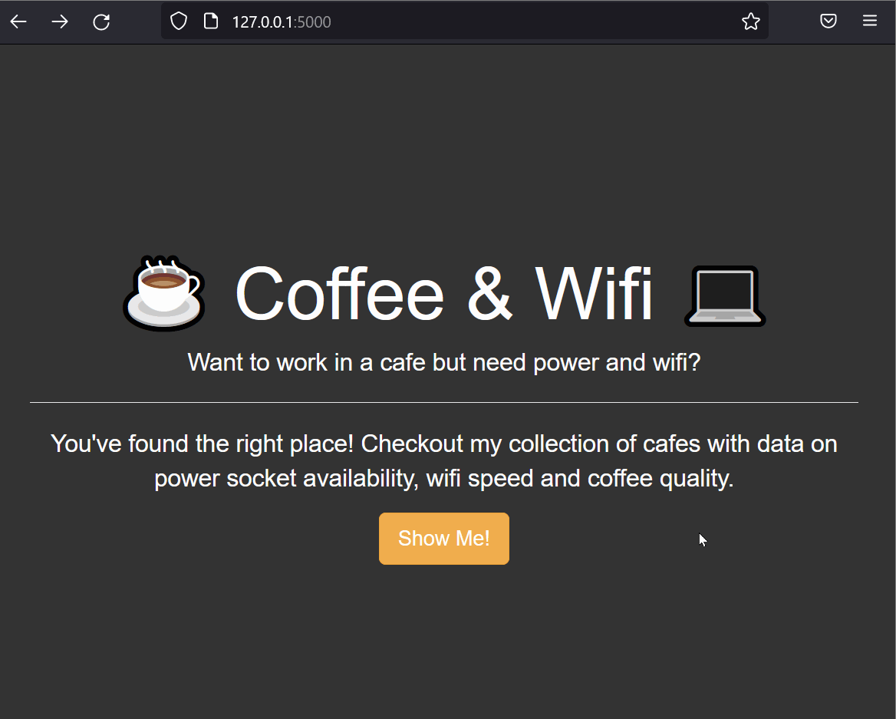

# Cafe & WiFi Finder (Flask)

> **Live Demo:** [https://cafe-and-wifi-finder.onrender.com/cafes](https://cafe-and-wifi-finder.onrender.com/cafes) *(Note: Free-tier servers may take ~30-50 seconds to wake up on the first request).*

A simple Flask web application for displaying and managing cafe data.

## Description

This project uses Flask to load and display cafe information from a CSV file.  
It demonstrates working with datasets, basic routing, and custom styling alongside Bootstrap.

## Demo

