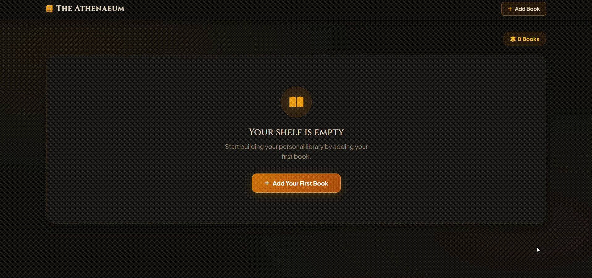

# Book Collection Manager (Flask + SQLAlchemy)

> To try this project live, [click here](https://book-collection-manager-j8sl.onrender.com/) *(free-tier instances may take 30–50s to wake up).*

A simple Flask web application for managing a personal book collection.

## Description

This project allows users to add, view, edit, and delete books stored in a SQLite database.  
It demonstrates CRUD operations using Flask, SQLAlchemy ORM, and a styled Bootstrap-based interface.

## Demo

