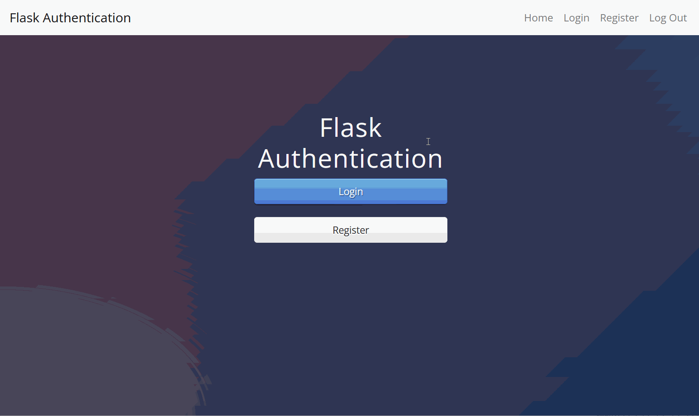

# User Authentication System (Flask)

> 🚀 **Live Demo:** [https://user-authentication-system-71jw.onrender.com](https://user-authentication-system-71jw.onrender.com/) *(Note: Free-tier servers may take ~30-50 seconds to wake up on the first request).*

A Flask web application implementing user registration and login functionality.

## Description

This project allows users to register, log in, and access protected pages using session-based authentication.  
It demonstrates secure password hashing, user management with SQLAlchemy, and route protection using Flask-Login.

## Demo

