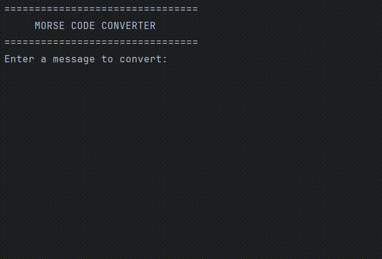

# Text to Morse Code Converter (Python)

## Overview

A simple command-line tool that converts any text message into Morse code.

## Description

The script takes a message from the user and translates each letter, digit, and space into its Morse code equivalent using a lookup dictionary.  
Unsupported characters are marked with a `?`, and the original message is displayed alongside the final Morse output.

## Demo

