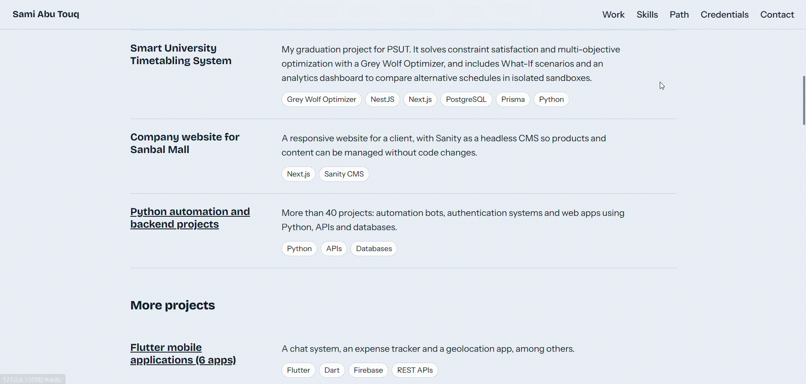

# Portfolio Website (Flask)

> **Live Demo:** [https://portfolio-website-utgq.onrender.com](https://portfolio-website-utgq.onrender.com/) *(Note: Free-tier servers may take ~30-50 seconds to wake up on the first request).*

A personal portfolio website built with Flask to showcase projects, skills, and credentials.

## Description

This project renders a single-page portfolio with hero, featured work, skills, career path, credentials, and contact sections.  
All content is kept in a single `data.py` file so it can be updated without touching the templates, and the contact form saves incoming messages to a local file.

## Demo

