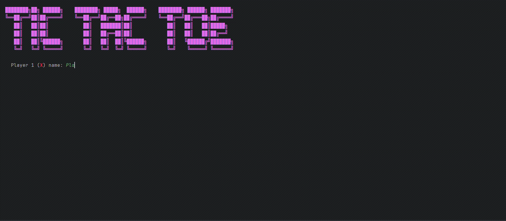

# Tic Tac Toe (Python)

## Overview

A two-player Tic Tac Toe game played directly in the terminal.

## Description

Two players enter their names and take turns picking squares from 1 to 9 on a colorful ANSI-styled board.  
The game detects wins and draws, highlights the winning line, keeps a running scoreboard across rounds, and lets players start a new round or quit at any time.

## Demo

