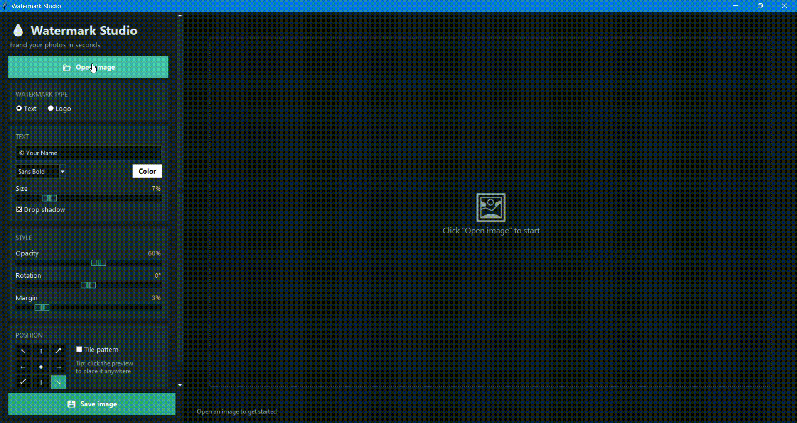

# Watermark Studio (Python + Tkinter)

## Overview

A desktop application for adding text or logo watermarks to images.

## Description

This project uses Tkinter and Pillow to let users load an image, choose between a text or PNG logo watermark, and see a live preview while adjusting the settings.  
It supports font selection, color, size, opacity, rotation, nine position presets, and a tile pattern, and the final result can be saved as a new image.

## Demo

