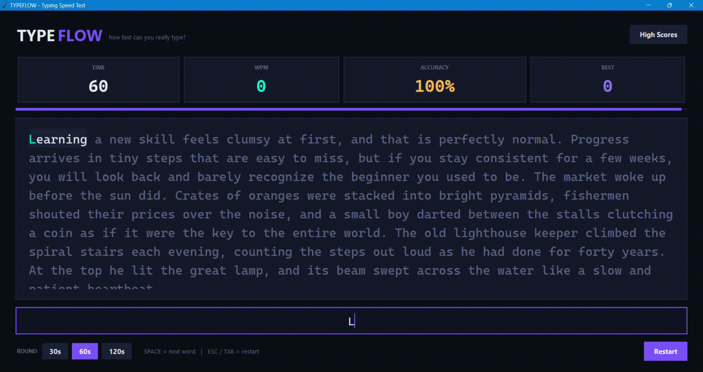

# TypeFlow - Typing Speed Test (Python + Tkinter)

## Overview

A desktop typing speed test and trainer built with Tkinter.

## Description

The app gives the user random passages to type in timed rounds of 30, 60, or 120 seconds while showing live WPM, accuracy, and a countdown progress bar.  
Words are colored as correct or wrong as you type, and a persistent high-score table is saved locally between sessions.

## Demo

