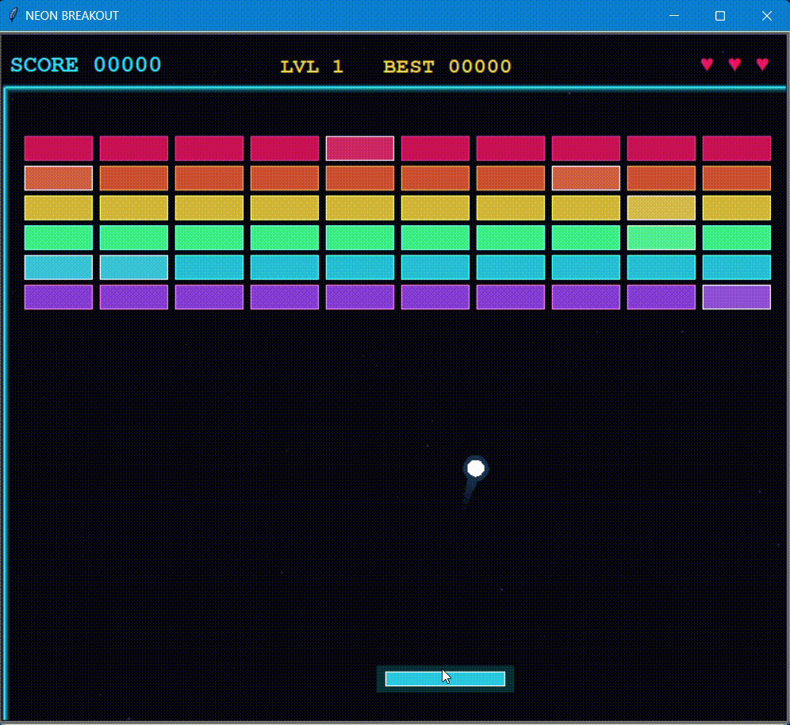

# Neon Breakout (Python + Turtle)

## Overview

A neon-styled Breakout arcade game built with Python's Turtle module.

## Description

The player controls a paddle with the keyboard or mouse to bounce balls and break bricks across increasingly fast levels.  
Special bricks drop power-ups such as multi-ball, wide paddle, fireball, slow motion, and extra lives, and the best score is saved between runs.

## Demo

