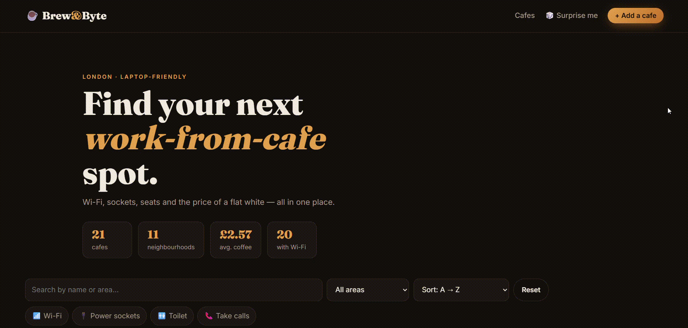

# Brew & Byte Cafe Directory (Flask + SQLite)

> To try this project live, [click here](https://brew-and-byte-cafe-directory.onrender.com/) *(free-tier instances may take 30–50s to wake up).*

A web application for browsing and managing laptop-friendly cafes.

## Description

This project stores cafe data in a SQLite database and lets users search, filter by location and amenities (Wi-Fi, power sockets, toilets, calls), and sort the results with live updates.  
Users can view cafe details, pick a random cafe, add, edit, and delete entries, and access the data through a simple JSON API.

## Demo

