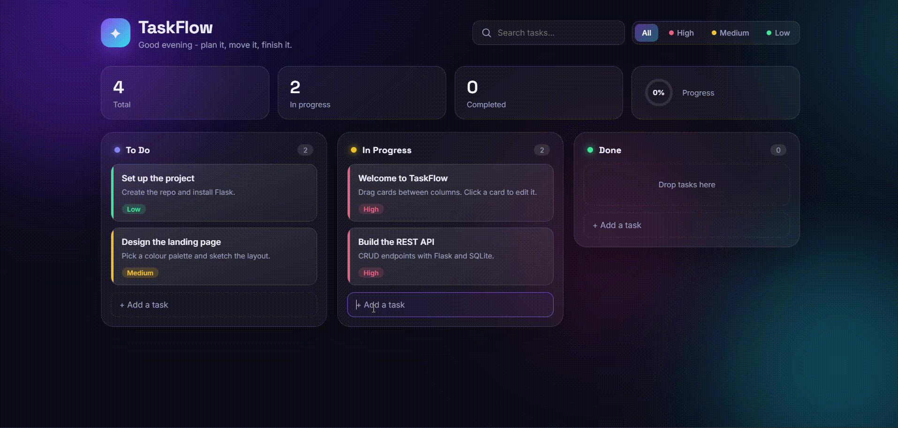

# TaskFlow Kanban Board (Flask + SQLite)

> **Live Demo:** [https://taskflow-kanban-board-aftw.onrender.com](https://taskflow-kanban-board-aftw.onrender.com/) *(Note: Free-tier servers may take ~30-50 seconds to wake up on the first request).*

A Kanban-style task manager built with Flask and SQLite.

## Description

Tasks are organized into To Do, In Progress, and Done columns and can be moved or reordered with drag and drop.  
It includes quick-add, task editing with priority and due date, search and priority filters, live progress stats, overdue highlighting, and a REST API that persists everything in a local database.

## Demo

