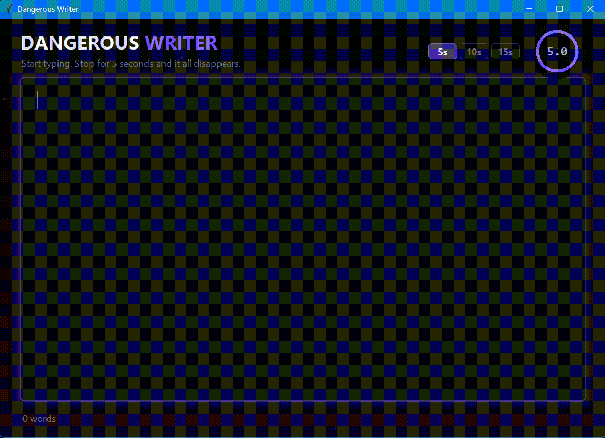

# Dangerous Writer (Python + Tkinter)

## Overview

A writing app that deletes everything you wrote if you stop typing.

## Description

The user picks an inactivity limit of 5, 10, or 15 seconds and starts writing in a distraction-free editor.  
If they pause for too long, the text fades away with a burn animation, which pushes them to keep writing without overthinking. A live word counter and a danger indicator show how close the text is to disappearing.

## Demo

