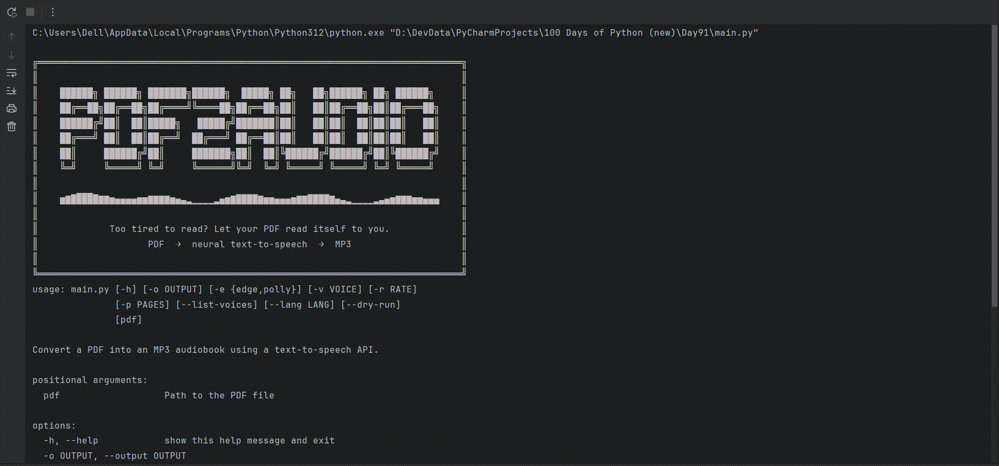

# PDF2Audio (Python CLI)

## Overview

A command-line tool that turns any PDF into an MP3 audiobook.

## Description

The script extracts text from a PDF with `pypdf`, splits it into chunks, and converts it to speech using free Microsoft neural voices through `edge-tts`.  
It offers options for voice, speaking speed, page ranges, output path, and a dry-run mode, with a rich terminal interface that shows live progress.

## Demo

