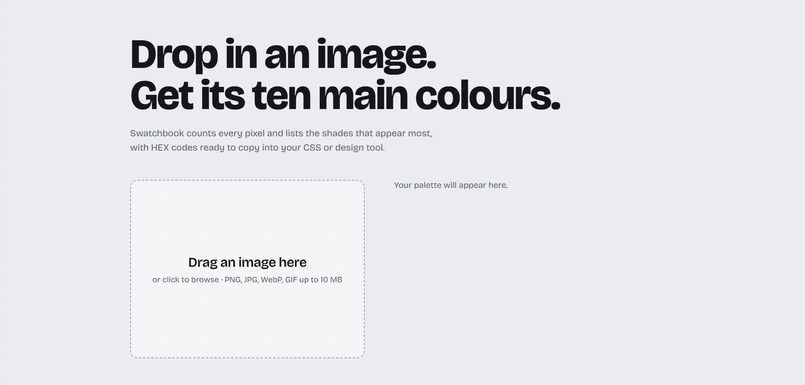

# Swatchbook Color Palette Extractor (Flask + NumPy)

> **Live Demo:** [https://swatchbook-color-palette-extractor.onrender.com](https://swatchbook-color-palette-extractor.onrender.com/) *(Note: Free-tier servers may take ~30-50 seconds to wake up on the first request).*

A web application that extracts the ten main colors from any image.

## Description

Users drag and drop an image, and the server uses NumPy and Pillow to analyze its pixels and return the most dominant colors with their percentages.  
Each color shows its HEX and RGB values, can be copied with one click, and the whole palette can be exported as CSS variables.

## Demo

