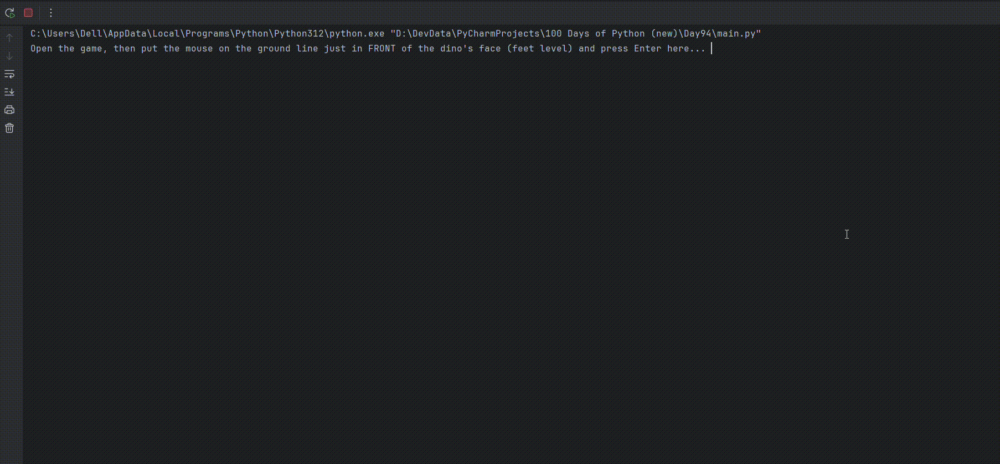

# Chrome Dino Bot (Python + PyAutoGUI)

## Overview

An automation bot that plays the Chrome Dinosaur game by itself.

## Description

After a quick calibration step, the bot captures a thin screenshot strip in front of the dino every frame and checks for pixels that differ from the background.  
It jumps over cacti, ducks under birds, and increases its look-ahead distance as the game speeds up, and it also works in night mode.

## Demo

