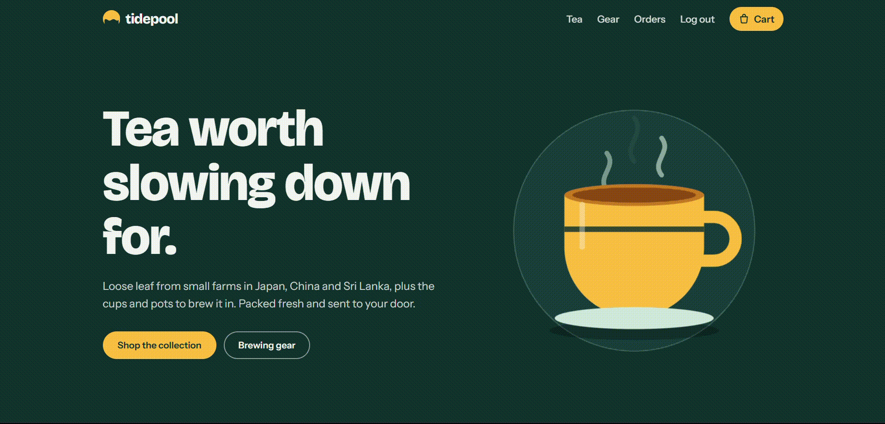

# Tidepool Tea Store (Flask + Stripe)

> 🚀 **Live Demo:** [https://tidepool-tea-store.onrender.com](https://tidepool-tea-store.onrender.com/) *(Note: Free-tier servers may take ~30-50 seconds to wake up on the first request).*

A complete small eCommerce store built with Flask and Stripe payments.

## Description

The store includes a product catalogue, a session-based shopping cart, user registration and login, and order history stored in a database.

Payments are handled by Stripe Checkout in test mode, with secure password hashing, CSRF protection, and an optional webhook to confirm orders.

## Test Payment

This project runs in Stripe test mode, so no real money is charged.
On the Stripe payment page, use:

- **Card number:** `4242 4242 4242 4242`
- **Expiry date:** Any future date (e.g., `12/30`)
- **CVC:** Any three-digit number (e.g., `123`)

## Set up Stripe (test mode)

1. Create a free account at [https://dashboard.stripe.com](https://dashboard.stripe.com) and stay in **Test mode**.
2. Copy your **Secret key** (`sk_test_...`) from Developers → API keys into `.env` as `STRIPE_SECRET_KEY`.
3. Add items to the cart, log in, and press **Pay with Stripe**.
4. Pay with the test card `4242 4242 4242 4242`, any future expiry, any CVC, and any ZIP.

To take real payments, activate your Stripe account and swap in your live secret key.

## Demo

